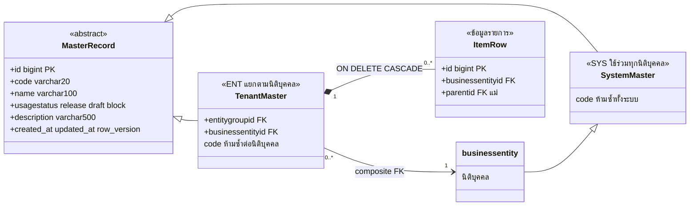
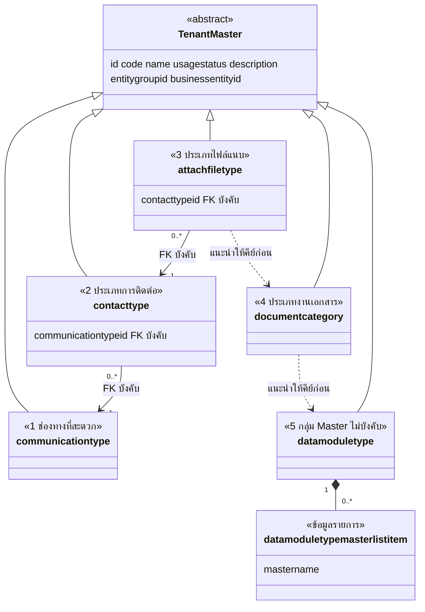
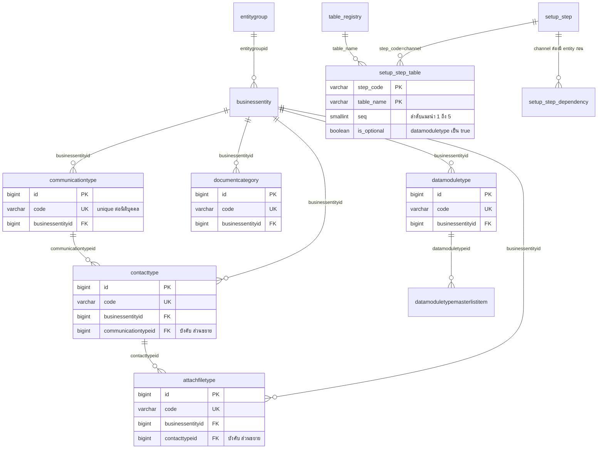
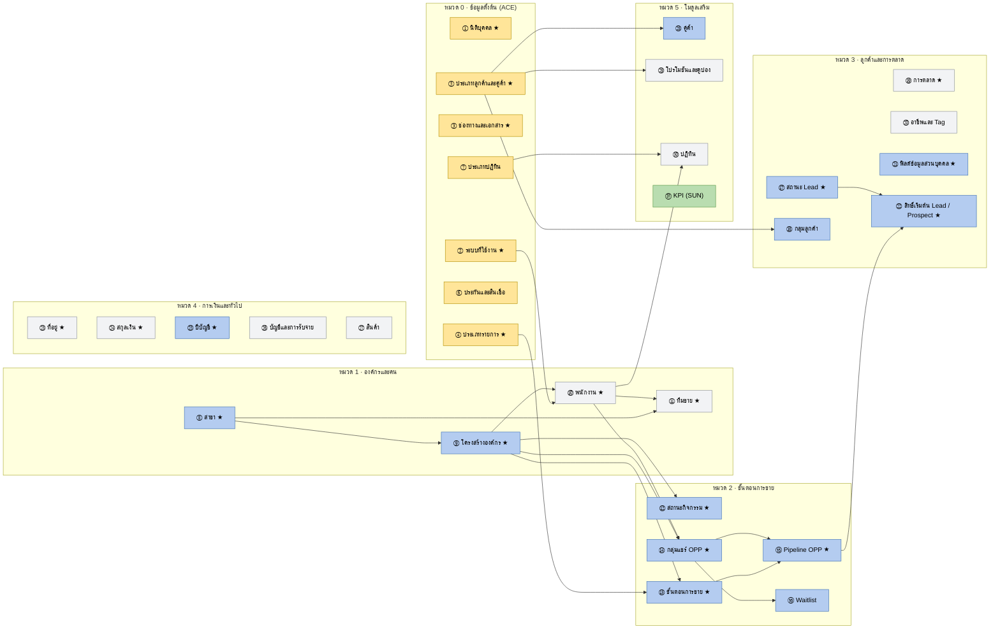
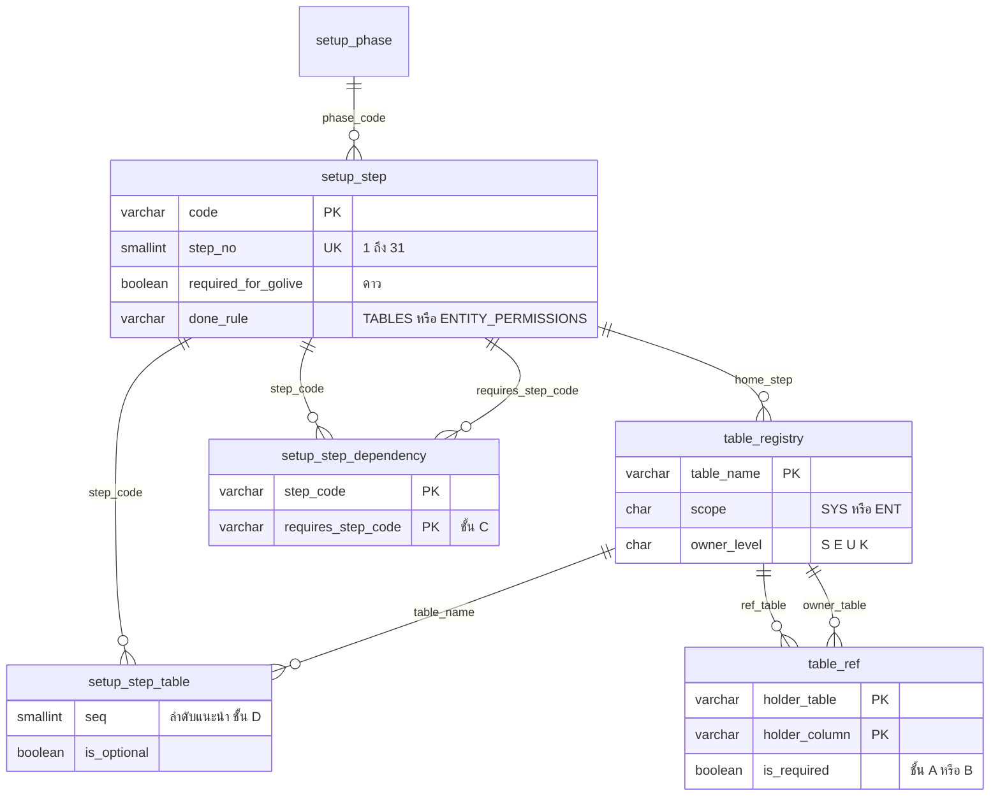

# Configuration & Master data — ออกแบบตารางและความสัมพันธ์

ร่างออกแบบเมื่อ 5 พ.ย. 2026 · **สถานะ: ร่าง** — DDL รันและทดสอบบน PostgreSQL จริง (PGlite 17) ผ่าน 70/70 กรณี (`tools/verify-master-schema.mjs`) แต่ **ยังไม่ได้ตรวจกับ backend / ทีมฐานข้อมูลจริง** และยังไม่ได้แก้โค้ด Angular

ต้นทาง (อ่านอย่างเดียว): `TripleSales_MasterData_SetupFlow.drawio` · `master-setup final mock up 30-10-2026.html` · และสเปก `Triple_Sales_Config_MasterData_Spec_v1.2` ชีต `8_Field_Spec` / `9_Validation_Rules` ที่อยู่โฟลเดอร์เดียวกัน (ใช้หาชนิด/ความยาวของทุกฟิลด์ — ถ้าไม่มีไฟล์นี้จะได้แค่ชื่อคอลัมน์ ไม่ได้ชนิดข้อมูล)

| ไฟล์ | คืออะไร |
|---|---|
| [`01-schema.sql`](01-schema.sql) | DDL ทั้งหมด: ตาราง · ข้อจำกัด · FK · index · comment ภาษาไทย · view · ฟังก์ชัน *(สร้างจากเครื่องมือ)* |
| [`02-setup-metadata.sql`](02-setup-metadata.sql) | ข้อมูลตั้งต้นของลำดับ step ①→㉛, "ต้องมีก่อน", ทะเบียนตาราง, ทะเบียน FK *(สร้างจากเครื่องมือ)* |
| [`03-example-channel.sql`](03-example-channel.sql) | ตัวอย่างลงมือจริงของ ③ ช่องทางและเอกสาร *(เขียนมือ, รันตรวจแล้ว)* |
| [`er-by-phase.md`](er-by-phase.md) | ER diagram แยกตามหมวด 0–5 *(สร้างจากเครื่องมือ)* |
| [`master-model.generated.json`](master-model.generated.json) | โมเดล normalize (ตาราง · คอลัมน์ · ชนิด · FK) ใช้ต่อกับ API / Angular ได้ |
| [`../../tools/gen-master-schema.mjs`](../../tools/gen-master-schema.mjs) | เครื่องมือสร้างไฟล์ข้างบน (ดู §9) |
| [`../../tools/verify-master-schema.mjs`](../../tools/verify-master-schema.mjs) | ทดสอบ DDL บน PostgreSQL จริง 70 กรณี (ดู §9) |

---

## 1. คำตอบสั้น ๆ

**AI ออกแบบตารางให้เรียกใช้ในหน้า HTML ได้ — ทำแล้ว:** ตัวเลขจริงจากไฟล์ที่ให้

<!-- gen:stats -->
| รายการ | จำนวน |
|---|---:|
| ตาราง master | 72 (ข้อมูลกลาง SYS 7 · แยกตามนิติบุคคล ENT 65) |
| ตารางรายการลูก (`…item`) | 37 |
| คอลัมน์ข้อมูล (ไม่นับ id/audit/tenant) | 664 |
| FK ระหว่าง master | 100 (ตารางหลัก 61 · รายการลูก 39) |
| ในนั้นเป็น FK **บังคับ** (ช่อง *) | 17 |
| FK อ้างตัวเอง | 6: `movementtypesettleruleitem.movementtype_settleid`, `positionorganize.subsidiariesid`, `position.commander_position1id`, `position.commander_position2id`, `positionparentpositionitem.parent_positionid`, `employeecoverforitem.cover_employeeid` |
| วงจรอ้างกัน | 2: `positionorganize` → `position` → `positionorganize` · `activitygroup` → `activity` → `activitygroup` |
| ตารางที่ไม่มี FK เข้า/ออกเลย | 12: `documentcategory`, `datamoduletype`, `businesstype`, `businesspartnertype`, `insurancetype`, `insurancenotificationtype`, `loantype`, `leadstatus`, `occupation`, `tag`, `dataattributeroleconfig`, `fiscalyears` |
<!-- /gen:stats -->

**เรื่อง ③ ช่องทางและเอกสาร — ผูก FK จริงตามที่ตัดสินใจ (5 พ.ย. 2026)** ใน mockup และสเปกเดิม 5 การ์ดของ ③ ไม่มี FK ถึงกันเลย ผมจึงเพิ่มเป็น **ส่วนขยายนอกสเปก** 2 คอลัมน์ เป็นสายเดียว :

```
ช่องทางที่สะดวก  ←  ประเภทการติดต่อ  ←  ประเภทไฟล์แนบ        (ประเภทงานเอกสาร และ กลุ่ม Master ไม่ผูกกับใคร)
communicationtype ← contacttype.communicationtypeid ← attachfiletype.contacttypeid
```

- เป็น **FK บังคับ (NOT NULL)** ตามที่คุณอธิบายตอนแรกว่า "ต้องมีข้อมูลก่อนถึงสร้างได้" — สร้าง "ประเภทการติดต่อ" โดยไม่มี "ช่องทางที่สะดวก" จึงถูกฐานข้อมูลปฏิเสธ (พิสูจน์ใน [`03-example-channel.sql`](03-example-channel.sql))
- แม่ต้องอยู่นิติบุคคลเดียวกัน (composite FK) · ลบแม่ที่มีลูกอ้างอยู่ไม่ได้ · ลำดับแท็บ 1 → 2 → 3 ใน drawio ตรงกับทิศ FK พอดี
- แท็บ 4–5 (ประเภทงานเอกสาร, กลุ่ม Master) **ไม่ได้ผูก** เพราะคุณไม่ได้กล่าวถึง — ลำดับยังเป็นแค่ "แนะนำ"
- ส่วนขยายนี้ **ไม่อยู่ใน mockup/สเปก/`settings.tables.ts`** ต้องไปเพิ่ม dropdown 2 ช่องในที่เหล่านั้นด้วย (ดู §4.4) ไม่งั้นหน้าจอกับฐานข้อมูลจะไม่ตรงกัน

<!-- gen:extensions -->
| คอลัมน์ที่เพิ่ม | อ้างถึง | บังคับ | ต้องไปแก้ที่ไหนอีก |
|---|---|---|---|
| `contacttype.communicationtypeid` (ช่องทางที่สะดวก) | `communicationtype` | บังคับ (NOT NULL) | mockup · สเปก 8_Field_Spec · `settings.tables.ts` |
| `attachfiletype.contacttypeid` (ประเภทการติดต่อ) | `contacttype` | บังคับ (NOT NULL) | mockup · สเปก 8_Field_Spec · `settings.tables.ts` |
<!-- /gen:extensions -->

---

## 2. ความสัมพันธ์มี 4 ชั้น (หัวใจของการออกแบบ)

drawio ใช้ลูกศรแทนความสัมพันธ์หลายแบบปนกัน — ในฐานข้อมูลต้องแยกเก็บคนละที่ ไม่งั้นจะบังคับเกินจริงหรือหลวมเกินไป:

| ชั้น | คืออะไร | เก็บที่ไหน | ใครบังคับ | ตัวอย่าง |
|---|---|---|---|---|
| **A. FK บังคับ** | ฟิลด์ช่อง `*` ที่ต้องเลือกรายการจาก master อื่น | คอลัมน์ `NOT NULL` + FK | **ฐานข้อมูล** | `customertype.companytypeid` → `companytype` |
| **B. FK ไม่บังคับ** | เลือกหรือไม่ก็ได้ / กรอกทีหลังได้ | คอลัมน์ NULL ได้ + FK | ฐานข้อมูล (ถ้าใส่ต้องมีจริงและเป็นนิติบุคคลเดียวกัน) | `employee.prefixid` → `prefix` |
| **C. ต้องมีก่อน (ระดับ step)** | ปุ่ม "สร้าง" ของ step กดไม่ได้ + ขึ้น `!` จนกว่า step ที่ต้องมีก่อนจะมีข้อมูล release ครบ (V13) | `con_master_setup_step_dependency` | **แอป/เซิร์ฟเวอร์** อ่านจาก view `v_setup_step_blocker` | ⑨ โครงสร้างองค์กร ← ⑧ สาขา |
| **D. ลำดับแท็บย่อยที่แนะนำ** | ลูกศรเทาในกรอบ — ลำดับที่ควรคีย์ | `con_master_setup_step_table.seq` | **ไม่บังคับ** (ใช้เปิดแท็บแรกที่ว่างให้) | ③ ประเภทงานเอกสาร → กลุ่ม Master (ไม่มี FK ถึงกัน) |

ชั้น A–B เป็น "ข้อมูลอ้างข้อมูล" จริง ๆ (ตัวเลขในตาราง §1), ชั้น C–D เป็น "ขั้นตอนการตั้งค่า" (กฎของหน้าจอ) จึงเก็บเป็นข้อมูลในตาราง `setup_*` ให้หน้าจอคำนวณแทนการฝังในโค้ด — เปลี่ยนลำดับได้โดยไม่ต้องแก้ DDL

### FK บังคับทุกเส้น (ชั้น A — "ต้องมีข้อมูลนี้ก่อนถึงบันทึกได้" แบบแข็งจริง · ✱ = ส่วนขยายนอกสเปก)

<!-- gen:required-fk -->
| # | คอลัมน์บังคับ (NOT NULL) | อ้างถึง | step ของผู้ถือ | step ของตารางที่ถูกอ้าง | ใครการันตีว่าต้องมีก่อน |
|---:|---|---|---|---|---|
| 1 | `businessentity.entitygroupid` | `entitygroup` | ① นิติบุคคล | ① นิติบุคคล | แท็บย่อยลำดับ 1 → 2 (ลำดับแนะนำ) + ฟอร์มบันทึกไม่ผ่านถ้าไม่เลือก |
| 2 | `contacttype.communicationtypeid` ✱ | `communicationtype` | ③ ช่องทางและเอกสาร | ③ ช่องทางและเอกสาร | แท็บย่อยลำดับ 1 → 2 (ลำดับแนะนำ) + ฟอร์มบันทึกไม่ผ่านถ้าไม่เลือก |
| 3 | `attachfiletype.contacttypeid` ✱ | `contacttype` | ③ ช่องทางและเอกสาร | ③ ช่องทางและเอกสาร | แท็บย่อยลำดับ 2 → 3 (ลำดับแนะนำ) + ฟอร์มบันทึกไม่ผ่านถ้าไม่เลือก |
| 4 | `customertype.companytypeid` | `companytype` | ⑤ ประเภทลูกค้าและคู่ค้า | ⑤ ประเภทลูกค้าและคู่ค้า | แท็บย่อยลำดับ 1 → 2 (ลำดับแนะนำ) + ฟอร์มบันทึกไม่ผ่านถ้าไม่เลือก |
| 5 | `positionbranchitem.branchid` | `branch` | ⑨ โครงสร้างองค์กร | ⑧ สาขา | "ต้องมีก่อน" ระดับ step + ฟอร์มบันทึกไม่ผ่านถ้าไม่เลือก |
| 6 | `employeesystemitem.systemnameid` | `systemname` | ⑩ พนักงาน | ② ระบบที่ใช้งาน | "ต้องมีก่อน" ระดับ step + ฟอร์มบันทึกไม่ผ่านถ้าไม่เลือก |
| 7 | `saleperson.employeeid` | `employee` | ⑪ ทีมขาย | ⑩ พนักงาน | "ต้องมีก่อน" ระดับ step + ฟอร์มบันทึกไม่ผ่านถ้าไม่เลือก |
| 8 | `salepersonsalegroupitem.salegroupid` | `salegroup` | ⑪ ทีมขาย | ⑪ ทีมขาย | แท็บย่อยลำดับ 1 → 2 (ลำดับแนะนำ) + ฟอร์มบันทึกไม่ผ่านถ้าไม่เลือก |
| 9 | `opportunityconfiggrouppipelineitem.activitygroupid` | `activitygroup` | ⑮ Pipeline OPP | ⑬ ขั้นตอนการขาย | "ต้องมีก่อน" ระดับ step + ฟอร์มบันทึกไม่ผ่านถ้าไม่เลือก |
| 10 | `opportunityconfigsteppipelineitem.activitygroupid` | `activitygroup` | ⑮ Pipeline OPP | ⑬ ขั้นตอนการขาย | "ต้องมีก่อน" ระดับ step + ฟอร์มบันทึกไม่ผ่านถ้าไม่เลือก |
| 11 | `opportunityconfigsteppipelineitem.activityid` | `activity` | ⑮ Pipeline OPP | ⑬ ขั้นตอนการขาย | "ต้องมีก่อน" ระดับ step + ฟอร์มบันทึกไม่ผ่านถ้าไม่เลือก |
| 12 | `customergroup.customertypeid` | `customertype` | ⑱ กลุ่มลูกค้า | ⑤ ประเภทลูกค้าและคู่ค้า | "ต้องมีก่อน" ระดับ step + ฟอร์มบันทึกไม่ผ่านถ้าไม่เลือก |
| 13 | `district.ms_province_id` | `province` | ㉓ ที่อยู่ | ㉓ ที่อยู่ | แท็บย่อยลำดับ 2 → 3 (ลำดับแนะนำ) + ฟอร์มบันทึกไม่ผ่านถ้าไม่เลือก |
| 14 | `exchangerate.currencyid` | `currency` | ㉔ สกุลเงิน | ㉔ สกุลเงิน | แท็บย่อยลำดับ 1 → 2 (ลำดับแนะนำ) + ฟอร์มบันทึกไม่ผ่านถ้าไม่เลือก |
| 15 | `material.materialgroupid` | `materialgroup` | ㉗ สินค้า | ㉗ สินค้า | แท็บย่อยลำดับ 2 → 3 (ลำดับแนะนำ) + ฟอร์มบันทึกไม่ผ่านถ้าไม่เลือก |
| 16 | `material.baseunitid` | `unitofmeasure` | ㉗ สินค้า | ㉗ สินค้า | แท็บย่อยลำดับ 1 → 3 (ลำดับแนะนำ) + ฟอร์มบันทึกไม่ผ่านถ้าไม่เลือก |
| 17 | `vendorgroup.vendortypeid` | `vendortype` | ㉘ คู่ค้า | ⑤ ประเภทลูกค้าและคู่ค้า | "ต้องมีก่อน" ระดับ step + ฟอร์มบันทึกไม่ผ่านถ้าไม่เลือก |
<!-- /gen:required-fk -->

---

## 3. หลักออกแบบตาราง

| เรื่อง | ที่ออกแบบ | เหตุผล / ที่มา |
|---|---|---|
| ฐานข้อมูล | PostgreSQL 14+ · schema `masterdata` | *สมมติฐาน* — backend `triple_sale_chat` ใช้ PostgreSQL แต่ไม่รู้ว่าบริการ master ใช้อะไร (§7 ข้อ 1) |
| **ชื่อตารางจริง** | **`con_master_` + ชื่อใน mockup** ทุกตารางที่สร้าง (115 ตาราง) เช่น `employee` → `con_master_employee`, รายการลูก `employeesystemitem` → `con_master_employeesystemitem`, metadata → `con_master_setup_step` ฯลฯ ; view/ฟังก์ชันไม่เติม prefix (`v_…`, `fn_…`) | ให้อยู่ schema ร่วมกับโมดูลอื่นได้โดยชื่อไม่ชน ; **ชื่อใน metadata / view / พารามิเตอร์ / API ยังเป็นชื่อใน mockup (ไม่มี prefix)** — แปลงเป็นชื่อจริงที่ `con_master_table_registry.physical_name` |
| ชื่อคอลัมน์ | **ตรงกับ mockup และสเปกทุกตัวอักษร** (รวมคำสะกดผิด เช่น `marketingchanel`) ยกเว้น 2 คอลัมน์ส่วนขยายของ ③ | ให้หน้า HTML/API จับคู่ 1:1 |
| ชื่อ constraint / index | `<ชนิด>_<ชื่อตารางจริง>_<คอลัมน์>` เช่น `fk_con_master_contacttype_communicationtypeid` ; ถ้าเกิน 63 ตัวอักษรตัดเหลือ 54 แล้วต่อรหัส hash 8 ตัว (ปัจจุบัน 36 ชื่อ) | ชื่อ index ต้องไม่ซ้ำทั้ง schema จึงใส่ prefix ด้วย |
| PK | `id BIGINT GENERATED BY DEFAULT AS IDENTITY` | สเปกบอกว่า "ค่าที่บันทึก = id" และรหัส (`code`) แก้ได้ภายหลัง จึงอ้างกันด้วย id |
| ขอบเขตข้อมูล | **SYS** 7 ตาราง (นิติบุคคล, กลุ่มนิติบุคคล, ระบบ, ประเทศ/จังหวัด/อำเภอ/ตำบล) ใช้ร่วมทุกนิติบุคคล · **ENT** 65 ตาราง มี `entitygroupid` + `businessentityid` | ตรงกับ `SYS` ใน mockup และฟิลด์ระบบ "ข้อมูลหลัก (ระบบ)" ในสเปก (ตรวจ 72/72 ตาราง) |
| รหัสซ้ำ (V02) | ENT: `UNIQUE (businessentityid, code)` · SYS: `UNIQUE (code)` — นับรวม draft/block | สเปก: "ห้ามซ้ำภายในนิติบุคคลเดียวกัน (รวม draft และ block)" |
| FK ระหว่าง master | **composite** `(businessentityid, col) → target (businessentityid, id)` สำหรับ ENT→ENT ; FK ธรรมดาเมื่อชี้ตาราง SYS | สเปก: "นิติบุคคลเดียวกับที่เลือกใน 'ใช้กับ'" — DB จึงกันการอ้างข้ามนิติบุคคลได้เอง (ทดสอบแล้ว) |
| entitygroup ซ้ำซ้อน | `(businessentityid, entitygroupid) → businessentity(id, entitygroupid)` | เก็บตามสเปกแต่ให้ตรงกับนิติบุคคลเสมอ |
| ลบ (V15) | FK = `ON DELETE RESTRICT` ; รายการลูก → แม่ = `CASCADE` | สเปก: ลบรายการที่ถูกอ้างอยู่ไม่ได้ → ให้ "เปลี่ยนเป็น block" แทน |
| สถานะ | `usagestatus VARCHAR(10) NOT NULL DEFAULT 'release'` + CHECK `release/draft/block` | |
| ชนิดข้อมูล | จาก `8_Field_Spec`: รหัส `VARCHAR(20)` · ชื่อ `VARCHAR(100)` · ข้อความยาว `VARCHAR(500/1000)` · เบอร์โทร `VARCHAR(15)`+regex V03 · จำนวนเต็ม `INTEGER` 0–999,999,999 · ทศนิยม `NUMERIC(11,2)` (สัดส่วน `NUMERIC(5,2)` 0–100) · วันที่ `DATE` · ไฟล์ `VARCHAR(500)` (path/URL ≤ 5 MB) | ตัวเลือก (`Select`) เป็น `VARCHAR` + CHECK ตามค่าใน mockup ตรง ๆ |
| ข้อมูลรายการ (แท็บลูกใน modal) | ตาราง `…item` มี `businessentityid` + `<แม่>id` ; แม่-ลูกเป็น composite FK | ลูกอ้าง master อื่นแบบ composite เหมือนกัน → อ้างข้ามนิติบุคคลไม่ได้ |
| คอลัมน์เทคนิค (ไม่มีใน mockup) | `created_at/by`, `updated_at/by`, `row_version` (ตารางหลัก) | สเปก U10 ตรวจ version ตอนบันทึก ; ใช้ `row_version` เพราะ `promotion` มีคอลัมน์ธุรกิจชื่อ `version` อยู่แล้ว |
| กฎเฉพาะ | สัดส่วนตำแหน่งรวม = 100 (V06) · วันสิ้นสุด ≥ วันเริ่ม (V12) · อ้างตัวเองไม่ได้ (6 คอลัมน์) · ตำแหน่งหลักของพนักงาน ≤ 1 | มาจากสเปกชีต 8–9 |

หมายเหตุ: เพราะชื่อตารางจริงมี prefix จึงไม่ชนคำพิเศษของ SQL (เช่นตาราง `position` กลายเป็น `con_master_position`) — ไม่ต้อง quote

---

## 4. ตัวอย่างเจาะลึก: ③ ช่องทางและเอกสาร ★

### 4.1 Class diagram — โครงสร้างทั่วไป

ทุกการ์ดใน drawio คือหนึ่งใน 3 รูปแบบนี้ (ตาราง ENT 65 · SYS 7 · รายการลูก 37) :



### 4.2 ③ ในฐานข้อมูล — ผูกเป็นสายตามที่ตัดสินใจ



- เส้นทึบมีหัวลูกศร = **FK จริง** (ส่วนขยายนอกสเปก 2 เส้น) — ฐานข้อมูลบังคับ
- เส้นประ = **"ลำดับแนะนำ" ไม่ใช่ FK** (ชั้น D) — มีแต่แถวใน `con_master_setup_step_table` (`seq` 1→5) ; ช่วงแท็บ 3→4→5 ยังเป็นแค่คำแนะนำ

### 4.3 ER ของ ③ + ตาราง metadata ที่ควบคุมลำดับ



ตัวอย่างผลจริงจาก [`03-example-channel.sql`](03-example-channel.sql) :

| สถานการณ์ | ผล |
|---|---|
| สร้าง `contacttype` โดยยังไม่มี `communicationtype` | **ปฏิเสธ** (NOT NULL) · หน้าจอ: แถบเหลือง V14 + dropdown ว่าง → บันทึกไม่ผ่าน · `v_field_prerequisite` บอกว่าขาดอะไร |
| สร้าง `attachfiletype` โดยยังไม่มี `contacttype` | **ปฏิเสธ** เช่นเดียวกัน |
| สร้างตามสาย ช่องทาง → ประเภทติดต่อ → ไฟล์แนบ | **สำเร็จ** |
| `contacttype` ของ SUN อ้าง `communicationtype` ของ GGW | **ปฏิเสธ** (composite FK — ต้องนิติบุคคลเดียวกัน) |
| ลบช่องทางที่มีประเภทการติดต่ออ้างอยู่ | **ปฏิเสธ** (RESTRICT) ; `fn_master_used_by` บอกว่าถูก `CALL` อ้าง → หน้าจอให้ "เปลี่ยนเป็น block" แทน |
| `documentcategory` | สร้างได้เลย ไม่ขึ้นกับใคร (ลำดับแท็บ 4 เป็นแค่คำแนะนำ) |
| ③ เสร็จเมื่อไหร่ | ครบ 4 ตารางบังคับ (`datamoduletype` ไม่บังคับ) — SUN `is_done = true` ขณะ GGW ยัง `false` (แยกตามนิติบุคคล) ; แท็บที่ควรเปิดให้ = แท็บแรกที่ยังไม่มี release |

### 4.4 ส่วนขยายนี้ต้องไปแก้ที่ไหนอีก / ถ้าเปลี่ยนใจ

ส่วนขยายอยู่ในค่าคงที่ `EXTENSIONS` ของ [`tools/gen-master-schema.mjs`](../../tools/gen-master-schema.mjs) (ไม่ใช่ใน mockup) — **ฐานข้อมูลจึงล้ำหน้าต้นทาง** ต้องตามไปแก้ให้ตรงกัน :

1. **mockup** — เพิ่มในนิยามตาราง `contacttype`: `{"n":"communicationtypeid","l":"ช่องทางที่สะดวก","q":1,"r":"communicationtype"}` และใน `attachfiletype`: `{"n":"contacttypeid","l":"ประเภทการติดต่อ","q":1,"r":"contacttype"}` — ตรรกะ V14 ของ mockup (`tblMiss`) จะเตือนเองอัตโนมัติ
2. **สเปก `8_Field_Spec`** — เพิ่มแถว 2 ฟิลด์ (ประเภท Reference, บังคับ, อ้างอิง Master ตามข้างบน)
3. **Angular** — นิยามตารางของหน้า ③ (`src/app/features/settings/settings.tables.ts` และคอลัมน์ใน `settings/v2/initial/channel.ts`) *(ยังไม่ได้แก้ — ขอบเขตรอบนี้คือฐานข้อมูล)*
4. พอ mockup มีฟิลด์แล้ว **ลบรายการนั้นออกจาก `EXTENSIONS`** — generator จะหยุดและบอกว่า "มีอยู่แล้วในต้นทาง" เพื่อกันนิยามซ้ำ

ที่ตัดสินไว้ (เจ้าของงานยืนยันแล้ว 5 พ.ย. 2026) :
- **ความสัมพันธ์เป็นหลายต่อหนึ่ง** — ประเภทการติดต่อ 1 ตัวสังกัดช่องทางได้ช่องทางเดียว (ประเภทไฟล์แนบ 1 ตัวสังกัดประเภทการติดต่อเดียว) ถ้าต้องสังกัดได้หลายแห่ง ต้องเปลี่ยนเป็นตารางรายการลูกแทนคอลัมน์
- **บังคับ (NOT NULL)** — ถ้าอยากให้เว้นว่างได้ ตั้ง `required: false` ใน `EXTENSIONS` แล้วรันใหม่ (กลายเป็นชั้น B)
- ฐานข้อมูลที่ **มีข้อมูลอยู่แล้ว** ต้องเพิ่มคอลัมน์แบบ NULL ได้ → เติมค่า → ค่อยตั้ง NOT NULL (DDL นี้เขียนสำหรับฐานข้อมูลใหม่)

---

## 5. ภาพรวมทั้ง 31 step

### 5.1 ลำดับ "ต้องมีก่อน" ระดับ step (ชั้น C)

- ลูกศร → = "ต้องมีก่อน" ที่ drawio แสดงเป็นกล่อง *ต้องมีก่อน:* ชี้จาก step ที่ต้องมีไปยัง step ที่ถูกบล็อก
- ไม่วาดเส้นจาก ① เพราะ **ทุก step ต้องมี ① ก่อน**ยกเว้น ② ระบบ และ ㉓ ที่อยู่ (กล่องที่ไม่มีเส้นเข้าจึงหมายถึงต้องมีแค่ ①)
- สีกล่อง = ผู้คีย์ตาม drawio : เหลือง System Configurator · ฟ้า Entity Configurator · เทา Master data user · เขียว KPI (SUN) · ★ = ต้องมีก่อนเปิดใช้งาน
- FK ไม่บังคับที่ชี้ข้าม step โดยไม่อยู่ใน "ต้องมีก่อน" ไม่วาดในภาพ (จะทำให้ภาพพันกัน) — อยู่ในตารางที่ §6

<!-- gen:step-flow -->

<!-- /gen:step-flow -->

### 5.2 Metadata ที่ทำให้ HTML คำนวณลำดับเองจากฐานข้อมูล



### 5.3 ER ของทุกตารางแยกตามหมวด

ดู [`er-by-phase.md`](er-by-phase.md) — 6 แผนภาพ แสดงคอลัมน์กุญแจและเส้น FK ทุกเส้น (เส้นทึบ = บังคับ, เส้น `|o` = ไม่บังคับ)

---

## 6. ผลการตรวจเทียบและจุดที่ควรรู้

**drawio ↔ mockup ↔ สเปก**

<!-- gen:crosscheck -->
ตรวจแล้ว **ตรงกันทั้งหมด** — 31/31 step (เลขที่ · ชื่อ · ★ · แท็บย่อยและลำดับ · "ต้องมีก่อน") ระหว่าง drawio กับ `ST` ใน mockup, และ FK บังคับทุกเส้นข้าม step อยู่ใน "ต้องมีก่อน"
<!-- /gen:crosscheck -->

- ชื่อฟิลด์และตารางใน mockup กับสเปก 8_Field_Spec **ตรงกัน 100%** (ทั้งตารางหลักและรายการลูก) ; ต่างกันจุดเดียวคือ `usagestatus` ที่สเปกเขียนว่าบังคับ ส่วน mockup ไม่ได้ติดดาว — ใช้ `NOT NULL DEFAULT 'release'`
- ข้อความในคำอธิบายสัญลักษณ์ของ drawio ว่า "ต้องคีย์ตัวบนก่อน" แรงกว่าที่ mockup ทำจริง (ไม่ล็อกปุ่ม) — ยกเว้น ③ หลังผูก FK ที่เป็นจริงแล้ว สำหรับกรอบอื่นแนะนำแก้เป็น "ควรคีย์ตัวบนก่อน"

**ลำดับแท็บย่อยขัดกับทิศ FK หรือไม่** (ตารางที่ถูกอ้างควรมาก่อนในลำดับแท็บ) — พบเฉพาะส่วนที่เป็นวงจรและเป็น FK ไม่บังคับ ซึ่งหมายเหตุใน mockup บอกวิธีแล้ว ("สร้างตำแหน่งให้ครบก่อน แล้วกลับมาใส่ผู้บังคับบัญชา", "ค่าเงื่อนไขพิเศษของกลุ่มขั้นตอนอ้างถึงขั้นตอน ปล่อยว่างไว้ก่อน"):

<!-- gen:order-violations -->
- positionorganizemanpoweritem.positionid (positionorganize แท็บ 2) → position (แท็บ 3) [ไม่บังคับ]
- positionorganizemanpoweritem.subsidairyofid (positionorganize แท็บ 2) → position (แท็บ 3) [ไม่บังคับ]
- activitygroup.conditionvalueid (activitygroup แท็บ 1) → activity (แท็บ 2) [ไม่บังคับ]
<!-- /gen:order-violations -->

**FK ไม่บังคับที่ข้าม step โดยไม่อยู่ใน "ต้องมีก่อน"** — ไม่ใช่ช่องโหว่ (บันทึกได้โดยไม่ต้องมี) แต่ผู้ใช้ควรรู้ว่าเลือกได้เมื่อ step ปลายทางมีข้อมูลแล้ว :

<!-- gen:soft-gaps -->
| step ที่ถือ FK | ชี้ไป step | คอลัมน์ (ไม่บังคับ) |
|---|---|---|
| ① นิติบุคคล | ㉓ ที่อยู่ | `businessentity.subdistrictid`, `businessentity.districtid`, `businessentity.provinceid`, `businessentity.countryid` |
| ① นิติบุคคล | ㉔ สกุลเงิน | `businessentity.currencyid` |
| ⑩ พนักงาน | ㉓ ที่อยู่ | `employee.provinceid`, `employee.districtid`, `employee.subdistrictid`, `employee.home_provinceid`, `employee.home_districtid`, `employee.home_subdistrictid` |
| ⑫ สถานะกิจกรรม | ㉛ KPI (SUN) | `keyactivitytype.kpiid` |
| ⑬ ขั้นตอนการขาย | ⑫ สถานะกิจกรรม | `activity.keyactivitytypeid` |
| ⑮ Pipeline OPP | ㉛ KPI (SUN) | `opportunityconfiggrouppipelineitem.slaunitid`, `opportunityconfigsteppipelineitem.slaunitid` |
| ㉖ บัญชีและการรับจ่าย | ㉘ คู่ค้า | `paymentmethod.thirdpartyid`, `receivemethod.thirdpartyid` |
| ㉘ คู่ค้า | ⑱ กลุ่มลูกค้า | `businesspartner.customergroupid` |
| ㉙ โปรโมชั่นและคูปอง | ⑧ สาขา | `coupon.branchid` |
| ㉙ โปรโมชั่นและคูปอง | ㉘ คู่ค้า | `coupon.couponcompanyid` |
<!-- /gen:soft-gaps -->

**วงจรอ้างกัน 3 จุด** (สร้างตารางได้เพราะ FK ถูกเพิ่มภายหลังและคอลัมน์ NULL ได้) : แผนก ↔ ตำแหน่งงาน · กลุ่มขั้นตอน ↔ ขั้นตอน (2 จุดนี้เป็นวงจรของ FK ข้อมูลตามตาราง §1) และ นิติบุคคล ↔ สกุลเงิน (จุดที่ 3 เกิดจากความเป็นเจ้าของ: สกุลเงินสังกัดนิติบุคคล แต่นิติบุคคลก็เลือกสกุลเงินหลัก — `businessentity.currencyid` จึงถูกบังคับให้เป็นสกุลเงินของนิติบุคคลนั้นเอง ด้วย FK `(id, currencyid) → currency(businessentityid, id)`)

**ความไม่สม่ำเสมอที่พบใน mockup/สเปก** (เก็บตามต้นทาง ไม่แก้เอง) :
- ค่า Y/N มี **5 แบบ** รวม 85 คอลัมน์ : `no/yes` 37 · `N/Y` 20 · `Y/N` 15 · `y/n` 8 (+`n/y` 1) · `open/close` 4 — แนะนำให้ API แปลงเป็นค่าเดียว
- ป้ายชื่อฟิลด์ของ "ช่องทางที่สะดวก" (`communicationtype`) เป็น "รหัส/ชื่อประเภทการติดต่อ" เหมือน "ประเภทการติดต่อ" (`contacttype`) ทั้งใน mockup และสเปก — น่าจะคัดลอกมา ผู้ใช้จะเห็นป้ายซ้ำสองแท็บใน ③
- ชื่อสะกดผิดที่คงไว้เพื่อให้ตรงต้นทาง : `marketingchanel`, `subsidairyofid`, `descript` (coupontype), `thirdpartyid` ("Thid party"), ชื่อคอลัมน์ FK ปนกัน (`ms_province_id` / `provinceid`)
- `businesspartner.city` / `country` (ป้าย "จังหวัด"/"ประเทศ") เป็นข้อความอิสระ ไม่ใช่ FK ไป `province`/`country`
- `exchangerate.exchangerate` เป็นทศนิยม 2 ตำแหน่งตามสเปก — อัตราของบางสกุล (เช่น JPY) ต้องละเอียดกว่านี้

---

## 7. สิ่งที่ต้องให้เจ้าของระบบตัดสิน

| # | ประเด็น | ที่ทำไว้ก่อน (เปลี่ยนได้โดยแก้ที่ generator) |
|---|---|---|
| 1 | ฐานข้อมูล / ชื่อ schema / ชนิด PK | PostgreSQL 14+, schema `masterdata`, `BIGINT identity` (ไม่ใช่ UUID) |
| 2 | ③: ผูก `contacttype` → `communicationtype` และ `attachfiletype` → `contacttype` | **ตัดสินและยืนยันแล้ว (5 พ.ย. 2026): ผูก แบบบังคับ หลายต่อหนึ่ง ไม่ผูกแท็บ 4–5** (§4) — เหลือแค่ ใครไปแก้ mockup/สเปก/Angular ให้ตรง (§4.4) |
| 3 | เก็บ `entitygroupid` ซ้ำในทุกตาราง ENT ตามสเปก หรือตัดแล้วดึงผ่านนิติบุคคล | เก็บ + composite FK กันไม่ให้ไม่ตรง (ข้อเสีย: ย้ายนิติบุคคลข้ามกลุ่มหลังมีข้อมูลทำไม่ได้) |
| 4 | V09: เลือก master ที่เป็น `block` ไม่ได้ — FK บังคับไม่ได้ | ตรวจที่แอป/เซิร์ฟเวอร์ (dropdown กรอง `release` + ตรวจซ้ำตอนบันทึก) ; อยากให้ DB กันด้วยต้องใช้ trigger |
| 5 | UNIQUE ของรายการลูก (V08 "เลือกซ้ำ") | ใส่เฉพาะรายการที่มี reference เดียวและไม่มีช่วงวันที่ ; ที่เหลือตรวจที่แอป (ตารางข้างล่าง) |
| 6 | ทศนิยมอัตราแลกเปลี่ยน | 2 ตำแหน่งตามสเปก (§6) |
| 7 | สิทธิ์ราย role ต่อตาราง (Q11 "รอข้อมูล") | **ไม่อยู่ในร่างนี้** — มีแค่ `owner_level` S/E/U/K ใน `con_master_table_registry` |
| 8 | ที่เก็บไฟล์รูป/เอกสาร (≤ 5 MB) | เก็บ path/URL ใน `VARCHAR(500)` ; ตัวไฟล์อยู่ object storage (ยังไม่ได้ออกแบบ) |

ตารางรายการลูกที่ **ไม่** ใส่ UNIQUE :

<!-- gen:item-unique -->
| ตารางรายการลูก | เหตุที่ไม่ใส่ UNIQUE |
|---|---|
| `datamoduletypemasterlistitem` | ไม่มี reference |
| `movementtypetxtypeitem` | ไม่มี reference |
| `positionorganizemanpoweritem` | มี reference หลายตัว (`positionid`, `subsidairyofid`) |
| `positionrolepositionitem` | ไม่มี reference |
| `activityconfigconfigitem` | มี reference หลายตัว (`activitygroup_fromid`, `activitystep_fromid`, `activitygroup_toid`, `activitystep_toid`) |
| `opportunityconfigconfigitem` | มี reference หลายตัว (`activitygroup_fromid`, `activity_fromid`, `activitygroup_toid`, `activity_toid`) |
| `opportunityconfiggrouppipelineitem` | มี reference หลายตัว (`activitygroupid`, `slaunitid`) |
| `opportunityconfigsteppipelineitem` | มี reference หลายตัว (`activitygroupid`, `activityid`, `slaunitid`) |
| `opportunityconfigexresponsiblepersonitem` | ไม่มี reference |
| `opportunityconfigsharinggroupitem` | มี reference หลายตัว (`activityid`, `sharinggroupid`) |
| `dataattributeroleconfigpdpaitem` | ไม่มี reference |
| `dataattributeroleconfigcriticalitem` | ไม่มี reference |
| `dataattributeroleconfigfinancialitem` | ไม่มี reference |
| `dataattributeroleconfigstrategicitem` | ไม่มี reference |
| `materialpictureitem` | ไม่มี reference |
| `businesspartnercustomercontactitem` | ไม่มี reference |
| `calendarsharedtoitem` | มี reference หลายตัว (`employeeid`, `positionid`) |
<!-- /gen:item-unique -->

---

## 8. หน้า HTML เรียกใช้ฐานข้อมูลอย่างไร

| ในหน้าจอ (mockup) | ใช้อะไรในฐานข้อมูล |
|---|---|
| รายการในแท็บ (ค้นหารหัส/ชื่อ, กรองสถานะ) | `SELECT … FROM con_master_<ตาราง> WHERE businessentityid = :ent` (ตาราง SYS ไม่ต้องกรอง) — ค่า "ใช้กับ" คือ `businessentityid` |
| ปุ่ม **สร้าง** กดไม่ได้ + `!` (V13) | `SELECT missing_step_code FROM v_setup_step_blocker WHERE businessentityid = :ent AND step_code = :step` ; ว่าง = กดได้ |
| แถบเหลือง "ต้องมี X ที่เป็น release ก่อน" (V14) | `v_field_prerequisite` (เฉพาะฟิลด์บังคับที่ตารางปลายทางยังว่าง) |
| ตัวเลือกใน dropdown ของฟิลด์อ้างอิง | `WHERE businessentityid = :ent AND (usagestatus = 'release' OR id = :ค่าที่เลือกอยู่)` |
| ติ๊กถูก/เสร็จ ของ step และ "พร้อมเปิดใช้งาน x/y" | `v_setup_step_status`, `v_go_live_progress` |
| รหัสซ้ำ (V02) | `UNIQUE` ตอบ error → แปลเป็น "รหัสนี้มีอยู่แล้ว" |
| แท็บ **ใช้อยู่ใน** และตรวจก่อนลบ (V15) | `fn_master_used_by(:ent, :ตาราง, :id)` (ส่ง **ชื่อใน mockup** เช่น `'communicationtype'` — ฟังก์ชันเติม prefix เอง) ; ตาราง SYS (เช่นจังหวัด) นับทุกนิติบุคคล |
| แท็บรายการลูก (`…item`) | `SELECT … FROM con_master_<…item> WHERE <แม่>id = :id ORDER BY id` ; บันทึกแบบแทนที่ทั้งชุดในธุรกรรมเดียว |
| step ㉒ สิทธิ์เริ่มต้น Lead/Prospect | แก้ 6 ฟิลด์บนแถว `businessentity` ของนิติบุคคลนั้น (`done_rule = ENTITY_PERMISSIONS`) |

---

## 9. สร้างใหม่และตรวจซ้ำ

ไฟล์ `01`, `02`, `er-by-phase.md`, `master-model.generated.json` และบล็อก `<!-- gen:… -->` ใน README นี้ **ถูกสร้างจากเครื่องมือ — อย่าแก้ด้วยมือ** ถ้า mockup/สเปก/drawio เปลี่ยน :

```bash
node tools/gen-master-schema.mjs
```

ค่าเริ่มต้นอ่านไฟล์จาก `C:/Krittikorn/ai/demo/New folder` ; ระบุเองได้ด้วย `--src <โฟลเดอร์>` หรือ `--html` `--xlsx` `--drawio` เครื่องมือจะ **หยุดและบอกเหตุผล** ถ้าพบชื่อฟิลด์ที่ไม่มีในสเปก, แปลงชนิดข้อมูลไม่ได้, ชื่อชนคำสงวน/คอลัมน์ระบบ หรือ drawio ไม่ตรงกับ mockup

ตรวจซ้ำบน PostgreSQL จริง (ไม่ต้องติดตั้งเซิร์ฟเวอร์ — ใช้ PGlite) :

```bash
npm install --no-save @electric-sql/pglite
node tools/verify-master-schema.mjs
```

สิ่งที่ตรวจไปแล้ว : โหลด DDL ทั้งหมด (115 ตาราง) ได้ และ **ทุกตารางขึ้นต้น `con_master_`** (ตรวจจาก `information_schema`) ; `physical_name` ใน `con_master_table_registry` ตรงกับตารางจริงครบ 72 ; `con_master_table_ref` ตรงกับ FK จริง 100/100 ; ③ สร้างลูกก่อนแม่ไม่ได้ / อ้างข้ามนิติบุคคลไม่ได้ / ลบแม่ที่มีลูกไม่ได้ ; รหัสซ้ำ/ต่างนิติบุคคล ; อ้างข้ามนิติบุคคลถูกปฏิเสธ ; ลบรายการที่ถูกอ้างถูกปฏิเสธ ; ลบแม่แล้วรายการลูกหายตาม ; V13/V14/ฟังก์ชัน "ใช้อยู่ใน" ให้ผลถูก ; CHECK ของสถานะ/รหัส/เบอร์โทร/สัดส่วน/ตำแหน่งหลัก ทำงาน

ยังไม่ได้ทำ : เติมข้อมูลตั้งต้นของ master (ข้อมูลตัวอย่างอยู่ใน mockup) · ตารางสิทธิ์ · API · แก้ฝั่ง Angular (`src/app/features/settings/**`) · ทดสอบประสิทธิภาพกับข้อมูลปริมาณมาก
