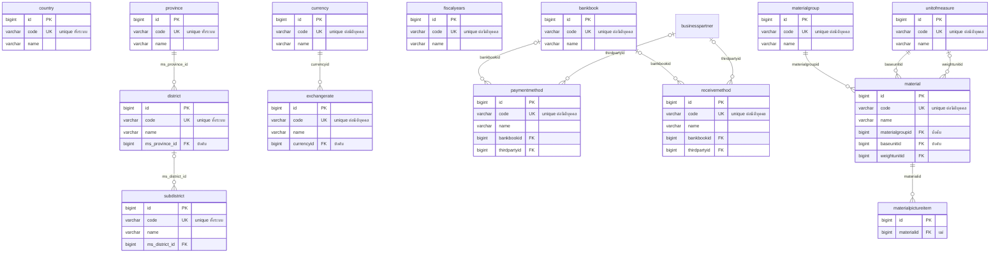

# ER diagram แยกตามหมวด (0–5)

> GENERATED โดย `tools/gen-master-schema.mjs` — อย่าแก้ด้วยมือ

อ่านอย่างไร
- แสดงเฉพาะ **คอลัมน์กุญแจ** (PK / UK / FK) ของแต่ละตาราง เพื่อให้เห็นความสัมพันธ์ — ฟิลด์ครบทุกตัวอยู่ใน `01-schema.sql`
- เส้น `||--o{` = FK **บังคับ** (ช่อง *, NOT NULL) · เส้น `|o--o{` = FK **ไม่บังคับ** (NULL ได้ คีย์ทีหลังได้)
- **ชื่อในแผนภาพคือชื่อใน mockup/API** — ชื่อตารางจริงในฐานข้อมูลขึ้นต้นด้วย `con_master_` (เช่น `employee` = `con_master_employee`)
- ตารางที่ไม่มีรายละเอียดคอลัมน์ในกรอบ = ตารางของหมวดอื่นที่ถูกอ้างถึง
- ตาราง ENT ทุกตารางมี `entitygroupid` + `businessentityid` (ไม่วาดเส้นเพื่อไม่ให้รก) — ดู README §3
- ตารางที่ลงท้าย `…item` = ข้อมูลรายการ (แท็บลูกในหน้า modal) ผูกกับแม่ด้วย ON DELETE CASCADE

## หมวด 0 · ข้อมูลตั้งต้น (ACE)

```mermaid
erDiagram
  entitygroup {
    bigint id PK
    varchar code UK "unique ทั้งระบบ"
    varchar name
  }
  businessentity {
    bigint id PK
    varchar code UK "unique ทั้งระบบ"
    varchar name
    bigint entitygroupid FK "บังคับ"
    bigint subdistrictid FK
    bigint districtid FK
    bigint provinceid FK
    bigint countryid FK
    bigint currencyid FK
  }
  systemname {
    bigint id PK
    varchar code UK "unique ทั้งระบบ"
    varchar name
  }
  communicationtype {
    bigint id PK
    varchar code UK "unique ต่อนิติบุคคล"
    varchar name
  }
  contacttype {
    bigint id PK
    varchar code UK "unique ต่อนิติบุคคล"
    varchar name
    bigint communicationtypeid FK "บังคับ"
  }
  attachfiletype {
    bigint id PK
    varchar code UK "unique ต่อนิติบุคคล"
    varchar name
    bigint contacttypeid FK "บังคับ"
  }
  documentcategory {
    bigint id PK
    varchar code UK "unique ต่อนิติบุคคล"
    varchar name
  }
  datamoduletype {
    bigint id PK
    varchar code UK "unique ต่อนิติบุคคล"
    varchar name
  }
  datamoduletypemasterlistitem {
    bigint id PK
    bigint datamoduletypeid FK "แม่"
  }
  movementtype {
    bigint id PK
    varchar code UK "unique ต่อนิติบุคคล"
    varchar name
  }
  movementtypetxtypeitem {
    bigint id PK
    bigint movementtypeid FK "แม่"
  }
  movementtypesettleruleitem {
    bigint id PK
    bigint movementtypeid FK "แม่"
    bigint movementtype_settleid FK
  }
  companytype {
    bigint id PK
    varchar code UK "unique ต่อนิติบุคคล"
    varchar name
  }
  customertype {
    bigint id PK
    varchar code UK "unique ต่อนิติบุคคล"
    varchar name
    bigint companytypeid FK "บังคับ"
  }
  businesstype {
    bigint id PK
    varchar code UK "unique ต่อนิติบุคคล"
    varchar name
  }
  membertype {
    bigint id PK
    varchar code UK "unique ต่อนิติบุคคล"
    varchar name
  }
  businesspartnertype {
    bigint id PK
    varchar code UK "unique ต่อนิติบุคคล"
    varchar name
  }
  vendortype {
    bigint id PK
    varchar code UK "unique ต่อนิติบุคคล"
    varchar name
  }
  coupontype {
    bigint id PK
    varchar code UK "unique ต่อนิติบุคคล"
    varchar name
  }
  insurancetype {
    bigint id PK
    varchar code UK "unique ต่อนิติบุคคล"
    varchar name
  }
  insurancenotificationtype {
    bigint id PK
    varchar code UK "unique ต่อนิติบุคคล"
    varchar name
  }
  loantype {
    bigint id PK
    varchar code UK "unique ต่อนิติบุคคล"
    varchar name
  }
  calendartype {
    bigint id PK
    varchar code UK "unique ต่อนิติบุคคล"
    varchar name
  }
  entitygroup ||--o{ businessentity : "entitygroupid"
  subdistrict |o--o{ businessentity : "subdistrictid"
  district |o--o{ businessentity : "districtid"
  province |o--o{ businessentity : "provinceid"
  country |o--o{ businessentity : "countryid"
  currency |o--o{ businessentity : "currencyid"
  communicationtype ||--o{ contacttype : "communicationtypeid"
  contacttype ||--o{ attachfiletype : "contacttypeid"
  datamoduletype ||--o{ datamoduletypemasterlistitem : "datamoduletypeid"
  movementtype ||--o{ movementtypetxtypeitem : "movementtypeid"
  movementtype ||--o{ movementtypesettleruleitem : "movementtypeid"
  movementtype |o--o{ movementtypesettleruleitem : "movementtype_settleid"
  companytype ||--o{ customertype : "companytypeid"
```

## หมวด 1 · องค์กรและคน

```mermaid
erDiagram
  branch {
    bigint id PK
    varchar code UK "unique ต่อนิติบุคคล"
    varchar name
  }
  department {
    bigint id PK
    varchar code UK "unique ต่อนิติบุคคล"
    varchar name
  }
  positionorganize {
    bigint id PK
    varchar code UK "unique ต่อนิติบุคคล"
    varchar name
    bigint subsidiariesid FK
  }
  positionorganizemanpoweritem {
    bigint id PK
    bigint positionorganizeid FK "แม่"
    bigint positionid FK
    bigint subsidairyofid FK
  }
  position {
    bigint id PK
    varchar code UK "unique ต่อนิติบุคคล"
    varchar name
    bigint positionorganizeid FK
    bigint commander_position1id FK
    bigint commander_position2id FK
  }
  positionbranchitem {
    bigint id PK
    bigint positionid FK "แม่"
    bigint branchid FK "บังคับ"
  }
  positionparentpositionitem {
    bigint id PK
    bigint positionid FK "แม่"
    bigint parent_positionid FK
  }
  positionrolepositionitem {
    bigint id PK
    bigint positionid FK "แม่"
  }
  prefix {
    bigint id PK
    varchar code UK "unique ต่อนิติบุคคล"
    varchar name
  }
  employee {
    bigint id PK
    varchar code UK "unique ต่อนิติบุคคล"
    varchar name
    bigint departmentid FK
    bigint prefixid FK
    bigint provinceid FK
    bigint districtid FK
    bigint subdistrictid FK
    bigint home_provinceid FK
    bigint home_districtid FK
    bigint home_subdistrictid FK
  }
  employeecoverforitem {
    bigint id PK
    bigint employeeid FK "แม่"
    bigint cover_employeeid FK
  }
  employeesubpositionitem {
    bigint id PK
    bigint employeeid FK "แม่"
    bigint positionid FK
  }
  employeesystemitem {
    bigint id PK
    bigint employeeid FK "แม่"
    bigint systemnameid FK "บังคับ"
  }
  employeebranchitem {
    bigint id PK
    bigint employeeid FK "แม่"
    bigint ms_branch_id FK
  }
  salegroup {
    bigint id PK
    varchar code UK "unique ต่อนิติบุคคล"
    varchar name
    bigint branchid FK
  }
  saleperson {
    bigint id PK
    varchar code UK "unique ต่อนิติบุคคล"
    varchar name
    bigint employeeid FK "บังคับ"
  }
  salepersonsalegroupitem {
    bigint id PK
    bigint salepersonid FK "แม่"
    bigint salegroupid FK "บังคับ"
  }
  positionorganize |o--o{ positionorganize : "subsidiariesid"
  positionorganize ||--o{ positionorganizemanpoweritem : "positionorganizeid"
  position |o--o{ positionorganizemanpoweritem : "positionid"
  position |o--o{ positionorganizemanpoweritem : "subsidairyofid"
  positionorganize |o--o{ position : "positionorganizeid"
  position |o--o{ position : "commander_position1id"
  position |o--o{ position : "commander_position2id"
  position ||--o{ positionbranchitem : "positionid"
  branch ||--o{ positionbranchitem : "branchid"
  position ||--o{ positionparentpositionitem : "positionid"
  position |o--o{ positionparentpositionitem : "parent_positionid"
  position ||--o{ positionrolepositionitem : "positionid"
  department |o--o{ employee : "departmentid"
  prefix |o--o{ employee : "prefixid"
  province |o--o{ employee : "provinceid"
  district |o--o{ employee : "districtid"
  subdistrict |o--o{ employee : "subdistrictid"
  province |o--o{ employee : "home_provinceid"
  district |o--o{ employee : "home_districtid"
  subdistrict |o--o{ employee : "home_subdistrictid"
  employee ||--o{ employeecoverforitem : "employeeid"
  employee |o--o{ employeecoverforitem : "cover_employeeid"
  employee ||--o{ employeesubpositionitem : "employeeid"
  position |o--o{ employeesubpositionitem : "positionid"
  employee ||--o{ employeesystemitem : "employeeid"
  systemname ||--o{ employeesystemitem : "systemnameid"
  employee ||--o{ employeebranchitem : "employeeid"
  branch |o--o{ employeebranchitem : "ms_branch_id"
  branch |o--o{ salegroup : "branchid"
  employee ||--o{ saleperson : "employeeid"
  saleperson ||--o{ salepersonsalegroupitem : "salepersonid"
  salegroup ||--o{ salepersonsalegroupitem : "salegroupid"
```

## หมวด 2 · ขั้นตอนการขาย

```mermaid
erDiagram
  activitystatus {
    bigint id PK
    varchar code UK "unique ต่อนิติบุคคล"
    varchar name
    bigint departmentid FK
  }
  keyactivitytype {
    bigint id PK
    varchar code UK "unique ต่อนิติบุคคล"
    varchar name
    bigint kpiid FK
  }
  activitygroup {
    bigint id PK
    varchar code UK "unique ต่อนิติบุคคล"
    varchar name
    bigint departmentid FK
    bigint conditionvalueid FK
    bigint movementtypeid FK
  }
  activitygrouppositionitem {
    bigint id PK
    bigint activitygroupid FK "แม่"
    bigint positionid FK
  }
  activity {
    bigint id PK
    varchar code UK "unique ต่อนิติบุคคล"
    varchar name
    bigint keyactivitytypeid FK
    bigint departmentid FK
    bigint activitygroupid FK
  }
  activityconfig {
    bigint id PK
    varchar code UK "unique ต่อนิติบุคคล"
    varchar name
  }
  activityconfigconfigitem {
    bigint id PK
    bigint activityconfigid FK "แม่"
    bigint activitygroup_fromid FK
    bigint activitystep_fromid FK
    bigint activitygroup_toid FK
    bigint activitystep_toid FK
  }
  activityinapp {
    bigint id PK
    varchar code UK "unique ต่อนิติบุคคล"
    varchar name
    bigint activitygroupid FK
  }
  oppsharinggroup {
    bigint id PK
    varchar code UK "unique ต่อนิติบุคคล"
    varchar name
  }
  oppsharinggrouppositionitem {
    bigint id PK
    bigint oppsharinggroupid FK "แม่"
    bigint positionid FK
  }
  oppsharinggroupemployeeitem {
    bigint id PK
    bigint oppsharinggroupid FK "แม่"
    bigint employeeid FK
  }
  opportunityconfig {
    bigint id PK
    varchar code UK "unique ต่อนิติบุคคล"
    varchar name
  }
  opportunityconfigconfigitem {
    bigint id PK
    bigint opportunityconfigid FK "แม่"
    bigint activitygroup_fromid FK
    bigint activity_fromid FK
    bigint activitygroup_toid FK
    bigint activity_toid FK
  }
  opportunityconfiggrouppipelineitem {
    bigint id PK
    bigint opportunityconfigid FK "แม่"
    bigint activitygroupid FK "บังคับ"
    bigint slaunitid FK
  }
  opportunityconfigsteppipelineitem {
    bigint id PK
    bigint opportunityconfigid FK "แม่"
    bigint activitygroupid FK "บังคับ"
    bigint activityid FK "บังคับ"
    bigint slaunitid FK
  }
  opportunityconfigpeersharingitem {
    bigint id PK
    bigint opportunityconfigid FK "แม่"
    bigint activitygroupid FK
  }
  opportunityconfigexresponsiblepersonitem {
    bigint id PK
    bigint opportunityconfigid FK "แม่"
  }
  opportunityconfigsharinggroupitem {
    bigint id PK
    bigint opportunityconfigid FK "แม่"
    bigint activityid FK
    bigint sharinggroupid FK
  }
  waitlisttype {
    bigint id PK
    varchar code UK "unique ต่อนิติบุคคล"
    varchar name
  }
  waitlistsharinggroup {
    bigint id PK
    varchar code UK "unique ต่อนิติบุคคล"
    varchar name
  }
  waitlistsharinggrouppositionitem {
    bigint id PK
    bigint waitlistsharinggroupid FK "แม่"
    bigint positionid FK
  }
  waitlistsharinggroupemployeeitem {
    bigint id PK
    bigint waitlistsharinggroupid FK "แม่"
    bigint employeeid FK
  }
  waitlist {
    bigint id PK
    varchar code UK "unique ต่อนิติบุคคล"
    varchar name
    bigint waitlisttypeid FK
  }
  waitlistoppsharinggroupitem {
    bigint id PK
    bigint waitlistid FK "แม่"
    bigint opp_sharing_groupid FK
  }
  waitlistwaitsharinggroupitem {
    bigint id PK
    bigint waitlistid FK "แม่"
    bigint waitlist_sharing_groupid FK
  }
  department |o--o{ activitystatus : "departmentid"
  kpiunit |o--o{ keyactivitytype : "kpiid"
  department |o--o{ activitygroup : "departmentid"
  activity |o--o{ activitygroup : "conditionvalueid"
  movementtype |o--o{ activitygroup : "movementtypeid"
  activitygroup ||--o{ activitygrouppositionitem : "activitygroupid"
  position |o--o{ activitygrouppositionitem : "positionid"
  keyactivitytype |o--o{ activity : "keyactivitytypeid"
  department |o--o{ activity : "departmentid"
  activitygroup |o--o{ activity : "activitygroupid"
  activityconfig ||--o{ activityconfigconfigitem : "activityconfigid"
  activitygroup |o--o{ activityconfigconfigitem : "activitygroup_fromid"
  activity |o--o{ activityconfigconfigitem : "activitystep_fromid"
  activitygroup |o--o{ activityconfigconfigitem : "activitygroup_toid"
  activity |o--o{ activityconfigconfigitem : "activitystep_toid"
  activitygroup |o--o{ activityinapp : "activitygroupid"
  oppsharinggroup ||--o{ oppsharinggrouppositionitem : "oppsharinggroupid"
  position |o--o{ oppsharinggrouppositionitem : "positionid"
  oppsharinggroup ||--o{ oppsharinggroupemployeeitem : "oppsharinggroupid"
  employee |o--o{ oppsharinggroupemployeeitem : "employeeid"
  opportunityconfig ||--o{ opportunityconfigconfigitem : "opportunityconfigid"
  activitygroup |o--o{ opportunityconfigconfigitem : "activitygroup_fromid"
  activity |o--o{ opportunityconfigconfigitem : "activity_fromid"
  activitygroup |o--o{ opportunityconfigconfigitem : "activitygroup_toid"
  activity |o--o{ opportunityconfigconfigitem : "activity_toid"
  opportunityconfig ||--o{ opportunityconfiggrouppipelineitem : "opportunityconfigid"
  activitygroup ||--o{ opportunityconfiggrouppipelineitem : "activitygroupid"
  kpiunit |o--o{ opportunityconfiggrouppipelineitem : "slaunitid"
  opportunityconfig ||--o{ opportunityconfigsteppipelineitem : "opportunityconfigid"
  activitygroup ||--o{ opportunityconfigsteppipelineitem : "activitygroupid"
  activity ||--o{ opportunityconfigsteppipelineitem : "activityid"
  kpiunit |o--o{ opportunityconfigsteppipelineitem : "slaunitid"
  opportunityconfig ||--o{ opportunityconfigpeersharingitem : "opportunityconfigid"
  activitygroup |o--o{ opportunityconfigpeersharingitem : "activitygroupid"
  opportunityconfig ||--o{ opportunityconfigexresponsiblepersonitem : "opportunityconfigid"
  opportunityconfig ||--o{ opportunityconfigsharinggroupitem : "opportunityconfigid"
  activity |o--o{ opportunityconfigsharinggroupitem : "activityid"
  oppsharinggroup |o--o{ opportunityconfigsharinggroupitem : "sharinggroupid"
  waitlistsharinggroup ||--o{ waitlistsharinggrouppositionitem : "waitlistsharinggroupid"
  position |o--o{ waitlistsharinggrouppositionitem : "positionid"
  waitlistsharinggroup ||--o{ waitlistsharinggroupemployeeitem : "waitlistsharinggroupid"
  employee |o--o{ waitlistsharinggroupemployeeitem : "employeeid"
  waitlisttype |o--o{ waitlist : "waitlisttypeid"
  waitlist ||--o{ waitlistoppsharinggroupitem : "waitlistid"
  oppsharinggroup |o--o{ waitlistoppsharinggroupitem : "opp_sharing_groupid"
  waitlist ||--o{ waitlistwaitsharinggroupitem : "waitlistid"
  waitlistsharinggroup |o--o{ waitlistwaitsharinggroupitem : "waitlist_sharing_groupid"
```

## หมวด 3 · ลูกค้าและการตลาด

```mermaid
erDiagram
  leadstatus {
    bigint id PK
    varchar code UK "unique ต่อนิติบุคคล"
    varchar name
  }
  customergroup {
    bigint id PK
    varchar code UK "unique ต่อนิติบุคคล"
    varchar name
    bigint customertypeid FK "บังคับ"
  }
  marketinggroup {
    bigint id PK
    varchar code UK "unique ต่อนิติบุคคล"
    varchar name
  }
  marketingchanel {
    bigint id PK
    varchar code UK "unique ต่อนิติบุคคล"
    varchar name
    bigint marketinggroupid FK
  }
  occupation {
    bigint id PK
    varchar code UK "unique ต่อนิติบุคคล"
    varchar name
  }
  tag {
    bigint id PK
    varchar code UK "unique ต่อนิติบุคคล"
    varchar name
  }
  dataattributeroleconfig {
    bigint id PK
    varchar code UK "unique ต่อนิติบุคคล"
    varchar name
  }
  dataattributeroleconfigpdpaitem {
    bigint id PK
    bigint dataattributeroleconfigid FK "แม่"
  }
  dataattributeroleconfigcriticalitem {
    bigint id PK
    bigint dataattributeroleconfigid FK "แม่"
  }
  dataattributeroleconfigfinancialitem {
    bigint id PK
    bigint dataattributeroleconfigid FK "แม่"
  }
  dataattributeroleconfigstrategicitem {
    bigint id PK
    bigint dataattributeroleconfigid FK "แม่"
  }
  customertype ||--o{ customergroup : "customertypeid"
  marketinggroup |o--o{ marketingchanel : "marketinggroupid"
  dataattributeroleconfig ||--o{ dataattributeroleconfigpdpaitem : "dataattributeroleconfigid"
  dataattributeroleconfig ||--o{ dataattributeroleconfigcriticalitem : "dataattributeroleconfigid"
  dataattributeroleconfig ||--o{ dataattributeroleconfigfinancialitem : "dataattributeroleconfigid"
  dataattributeroleconfig ||--o{ dataattributeroleconfigstrategicitem : "dataattributeroleconfigid"
```

## หมวด 4 · การเงินและทั่วไป

## หมวด 5 · โมดูลเสริม

```mermaid
erDiagram
  vendorgroup {
    bigint id PK
    varchar code UK "unique ต่อนิติบุคคล"
    varchar name
    bigint vendortypeid FK "บังคับ"
  }
  businesspartner {
    bigint id PK
    varchar code UK "unique ต่อนิติบุคคล"
    varchar name
    bigint customergroupid FK
    bigint vendorgroupid FK
  }
  businesspartnercustomercontactitem {
    bigint id PK
    bigint businesspartnerid FK "แม่"
  }
  promotion {
    bigint id PK
    varchar code UK "unique ต่อนิติบุคคล"
    varchar name
  }
  coupon {
    bigint id PK
    varchar code UK "unique ต่อนิติบุคคล"
    varchar name
    bigint branchid FK
    bigint couponcompanyid FK
    bigint coupontypeid FK
    bigint promotionid FK
  }
  couponmembertypeitem {
    bigint id PK
    bigint couponid FK "แม่"
    bigint membertypeid FK
  }
  couponcustomertypeitem {
    bigint id PK
    bigint couponid FK "แม่"
    bigint customertypeid FK
  }
  calendar {
    bigint id PK
    varchar code UK "unique ต่อนิติบุคคล"
    varchar name
    bigint calendartypeid FK
    bigint employeeid FK
  }
  calendarsharedtoitem {
    bigint id PK
    bigint calendarid FK "แม่"
    bigint employeeid FK
    bigint positionid FK
  }
  kpiunit {
    bigint id PK
    varchar code UK "unique ต่อนิติบุคคล"
    varchar name
  }
  kpitasktype {
    bigint id PK
    varchar code UK "unique ต่อนิติบุคคล"
    varchar name
  }
  kpilevel {
    bigint id PK
    varchar code UK "unique ต่อนิติบุคคล"
    varchar name
    bigint kpi_unitid FK
  }
  kpiproduct {
    bigint id PK
    varchar code UK "unique ต่อนิติบุคคล"
    varchar name
  }
  kpiproductlevelitem {
    bigint id PK
    bigint kpiproductid FK "แม่"
    bigint kpilevelid FK
  }
  kpicontact {
    bigint id PK
    varchar code UK "unique ต่อนิติบุคคล"
    varchar name
  }
  kpipillar {
    bigint id PK
    varchar code UK "unique ต่อนิติบุคคล"
    varchar name
  }
  kpitask {
    bigint id PK
    varchar code UK "unique ต่อนิติบุคคล"
    varchar name
    bigint kpi_unitid FK
  }
  kpipillartask {
    bigint id PK
    varchar code UK "unique ต่อนิติบุคคล"
    varchar name
    bigint kpitasktypeid FK
    bigint pillarid FK
    bigint productid FK
    bigint levelid FK
    bigint contact_channelid FK
  }
  kpipillartaskkpiitem {
    bigint id PK
    bigint kpipillartaskid FK "แม่"
    bigint kpitaskid FK
  }
  vendortype ||--o{ vendorgroup : "vendortypeid"
  customergroup |o--o{ businesspartner : "customergroupid"
  vendorgroup |o--o{ businesspartner : "vendorgroupid"
  businesspartner ||--o{ businesspartnercustomercontactitem : "businesspartnerid"
  branch |o--o{ coupon : "branchid"
  businesspartner |o--o{ coupon : "couponcompanyid"
  coupontype |o--o{ coupon : "coupontypeid"
  promotion |o--o{ coupon : "promotionid"
  coupon ||--o{ couponmembertypeitem : "couponid"
  membertype |o--o{ couponmembertypeitem : "membertypeid"
  coupon ||--o{ couponcustomertypeitem : "couponid"
  customertype |o--o{ couponcustomertypeitem : "customertypeid"
  calendartype |o--o{ calendar : "calendartypeid"
  employee |o--o{ calendar : "employeeid"
  calendar ||--o{ calendarsharedtoitem : "calendarid"
  employee |o--o{ calendarsharedtoitem : "employeeid"
  position |o--o{ calendarsharedtoitem : "positionid"
  kpiunit |o--o{ kpilevel : "kpi_unitid"
  kpiproduct ||--o{ kpiproductlevelitem : "kpiproductid"
  kpilevel |o--o{ kpiproductlevelitem : "kpilevelid"
  kpiunit |o--o{ kpitask : "kpi_unitid"
  kpitasktype |o--o{ kpipillartask : "kpitasktypeid"
  kpipillar |o--o{ kpipillartask : "pillarid"
  kpiproduct |o--o{ kpipillartask : "productid"
  kpilevel |o--o{ kpipillartask : "levelid"
  kpicontact |o--o{ kpipillartask : "contact_channelid"
  kpipillartask ||--o{ kpipillartaskkpiitem : "kpipillartaskid"
  kpitask |o--o{ kpipillartaskkpiitem : "kpitaskid"
```

